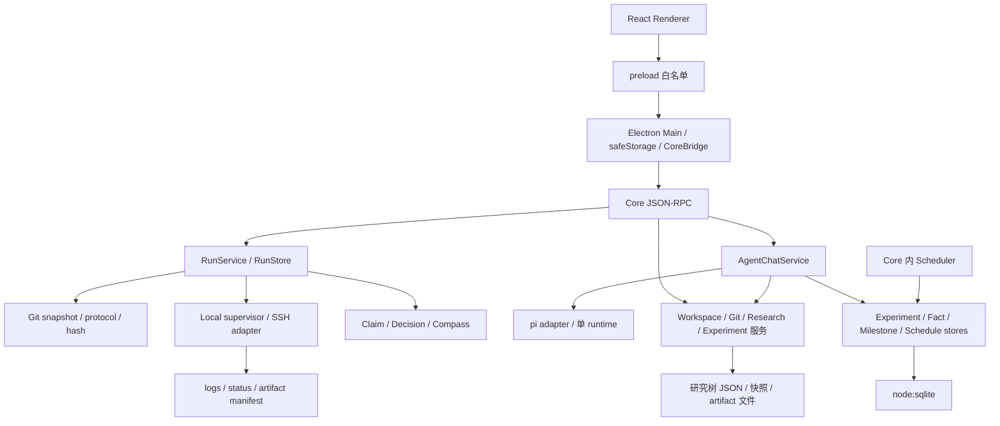

# 架构地图与演进边界

更新：2026-11-11 · 基础审计 `7b9b786`，含本轮闭环增量 · 演进已批准，见 [ADR-0006](../adr/0006-research-loop-evolution.md)

## 当前实际架构

主要入口：[main](../../apps/desktop/src/main/index.ts)、[preload](../../apps/desktop/src/preload/index.ts)、[Core CLI](../../apps/core/src/cli.ts)、[RPC](../../apps/core/src/rpc.ts)、[AgentChat](../../apps/core/src/agent-chat.ts)。

| 边界        | 当前事实                                                                                 | 演进目标                                                                         |
| ----------- | ---------------------------------------------------------------------------------------- | -------------------------------------------------------------------------------- |
| 桌面/副作用 | Renderer 经 preload/Main 调 Core；未发现 Renderer 直接 import fs/SQLite                  | 保持隔离；Main 收敛生命周期和凭据保管职责                                        |
| Agent/科研  | Core 持有科研 schema、提示与权限路由；pi 仅适配通用工具、会话和 provider，旧双接口已删除 | 保持 runtime-neutral 契约；新增科研能力在 Core/Research Skills 接入，见 ADR-0015 |
| 协议        | contracts 有基础契约，但业务 DTO 分散 Core/Renderer                                      | 跨进程 DTO 与校验 schema 单一来源；不把 RPC 大文件简单搬入 contracts             |
| 领域模型    | domain 主要是内存 ResearchEnvironment；生产逻辑在 Core                                   | 纯规则/状态机逐步进入 domain；I/O 留服务层                                       |
| 存储        | node:sqlite + 多个 Core store；研究树 JSON、JSONL session、归档 JSON                     | 明确每类记录的权威来源、版本、事务边界、迁移与备份                               |
| 模块目录    | db/coding/executors/artifacts/testkit 是预留目录                                         | 有稳定接口/实际代码后才迁包；不以空目录数量代表模块化程度                        |

本轮新增 Core RunService/RunStore/RunSnapshot、独立 Local supervisor、系统 OpenSSH 与原生 ssh2 薄适配；均使用同一 Job 协议。原生密码由 Main vault 加密，私有控制通道向 Core 注入，计划冻结非秘密连接身份；真实桌面恢复证据见[原生 SSH 验收](2026-11-11-native-ssh-acceptance.md)。AppSettings 等跨进程设置 DTO 来自 contracts，不再在 Main/preload/renderer 各维护一份。

工作区以独立 SQLite 锁库持有单写者锁，崩溃后由操作系统释放；Run 状态与事件在同一事务提交。方案撤回/替代保留 closure、审计及历史原始 JSON 迁移备份，不能再启动已关闭方案。冻结文件预览只读 manifest 中对应快照并核验大小、UTF-8 和 SHA-256，不读取当前工作树。

Agent 资源只来自宿主内存注入，不自动加载工作区扩展、磁盘模型配置、包或模板，见 [ADR-0015](../adr/0015-host-owned-agent-tools.md)。通用文件和 Skill 读取共用 Gateway：先规范化并解析物理路径，再保护内部目录/凭据；仅核验后的受管产物开放只读。Agent 归档必须引用精确成功 Run，Core 重核产物后派生数值与来源；模型和 Skill 共用无 Job token 的研究状态投影，见 [ADR-0017](../adr/0017-core-files-and-verified-agent-archive.md)。

Drizzle/FTS5、完整统一迁移框架与增量 SSH 仍未实现。工程方案中的目标图不能作为代码现状图。

## 建议目标边界

保留 Electron、TypeScript、Core、pi 和 SQLite 路线，先在 Core 内建立可测模块，再按稳定边界迁包。避免为了拆目录同时改行为和数据格式。

| 模块                  | 负责                                                | 不负责                           |
| --------------------- | --------------------------------------------------- | -------------------------------- |
| contracts             | IPC/RPC DTO、schema、事件版本、错误码               | pi、Electron、数据库实现         |
| domain                | 任务书冻结、Run 状态转换、可比性规则、证据/决策规则 | Shell、网络、文件和模型调用      |
| agent-runtime         | pi 生命周期、通用工具注册、流式事件、会话适配       | 科研对象持久化、人工确认决策     |
| Core policy / gateway | 动作副作用分类、权限/边界/审批、审计                | 依赖 system prompt 执行权限      |
| Core research         | 问题、假设、计划版本、Claim、Decision、Compass 投影 | 自己再实现一个模型工具循环       |
| Core runs             | 运行意图、幂等、状态核对、预算、收集、重试 attempt  | 将一次 Shell 返回直接当科学结论  |
| executors（后续）     | Local/SSH 的 submit/inspect/cancel/collect          | 审批、结论确认与研究策略         |
| artifacts（后续）     | manifest、按字节哈希、大小/类型、来源、缺件、保留   | 把文本 diff 当全部科研输出       |
| db（后续）            | repository、事务、版本迁移与备份恢复                | UI、pi 或执行器调用              |
| ui / desktop          | 视图和人类操作，遵循既有视觉合同                    | 直接读写科研数据库或授权模型自批 |

依赖方向继续遵守现有规范；新跨包依赖先检查环。领域状态用 ID/版本引用，不能依赖 pi session 的内部对象。

## 数据模型（已实现子集与后续边界）

| 对象                                 | 关键身份/关系                                                                    | 不变量                                                          |
| ------------------------------------ | -------------------------------------------------------------------------------- | --------------------------------------------------------------- |
| Project / Question                   | workspace、仓库、目标、约束、停止条件                                            | 问题独立于会话；UI 树不强制所有关系为单父                       |
| Hypothesis                           | 命题、反证条件、question links                                                   | 实验可检验多个假设；不能由运行退出码自动接受                    |
| Experiment                           | 方案意图、baseline、变量、parent、protocol                                       | 与一次真实执行分离；新想法/已冻结方案变更产生新版本或子实验     |
| PlanVersion / Approval               | 不可变内容、内容哈希、审批者、权限/预算范围                                      | 人批准具体版本；修改不能沿用旧确认                              |
| Run                                  | planVersion、attempt、code revision/snapshot、命令/cwd、参数/数据/环境身份、预算 | 先持久化运行意图，再启动；重复请求不能重复提交                  |
| ExecutionJob                         | runId、backend、remote identity、状态/日志游标                                   | 会话断开不等于任务失败；重启先核对；重试创建新 attempt          |
| EvaluationProtocol / ComparableGroup | 数据划分、指标/单位/方向、seed、环境约束、评测命令版本                           | 同组才直接比较；跨协议标明不可比，不能直接排名                  |
| Artifact / Manifest                  | runId/外部来源、sha256、大小、media type、原始/派生、父产物                      | 二进制也登记；缺件/超限可见；原始证据不能自动删除               |
| Analysis / EvidenceLink / Claim      | 分析脚本版本、输入/输出、支持/反证/限制、来源定位                                | 数值由工具计算；候选与已确认分离；多 Run 交叉引用、更正保留历史 |
| Decision / Compass                   | 继续/放弃/修复/停止、理由、证据、未决与下一步                                    | Compass 是结构化记录的投影，不产生第二份可漂移事实              |
| ChatSession                          | project/scope、runtime 映射、消息索引                                            | 会话是交互记录，不是证据、审批和预算的权威源                    |

先用两个样板验证最小字段，不为每个名词立即建表或抽象插件。已有 `RUN-*` 实验记录保留旧 ID 与迁移映射；缺少的代码/数据身份记录为 unknown，不编造历史来源。

## 两条执行路径

交互式编码：请求 → Core 权限 → 文件/命令/Git → diff/日志与审计。没有研究问题也应可用。

受管科研运行（本轮已接通最小路径）：提议 → 人工冻结计划和范围 → 持久运行意图 → 固定代码/输入 → 提交 Job → 核对/取消/超时 → 采集 → 完整性验证 → 确定性分析 → 候选结论 → 人工决策。

本轮 Run 状态为 `preparing → running → collecting → succeeded`，另有 `failed/canceled/unknown`；候选/确认结论独立于运行状态。排队、分析和人工审阅状态暂不混入 Job 生命周期。状态迁移需附依据与事件；运行完成、证据齐全、假设获支持是不同判断。

## 迁移与恢复

1. 先为权限、确认内容、研究树损坏/并发、归档缺件建立回归测试，再改数据结构。
2. 同一桌面分发内同步更新 contracts、Core、Main/preload 与 renderer，删除被替换的内部接口；有独立客户端时再定义必要的协议协商，不默认堆积兼容分支。
3. 存储变更先导出/备份，使用可重复的版本迁移；旧数据 fixture、失败中断、重开验证必须通过。
4. Run 与历史 experiment 保留可追溯引用和迁移映射；当前写入走单一路径，不维护两份可独立修改的权威记录。历史手工补录不冒充受管 Run。
5. 回滚应用前核对 schema 兼容性；不可逆迁移通过恢复备份回退，不让旧应用写未知 schema。

WAL/Drizzle、SSH 库、指标 tracker 都需要各自 ADR、许可与固定版本验证；此图没有批准新增依赖。
